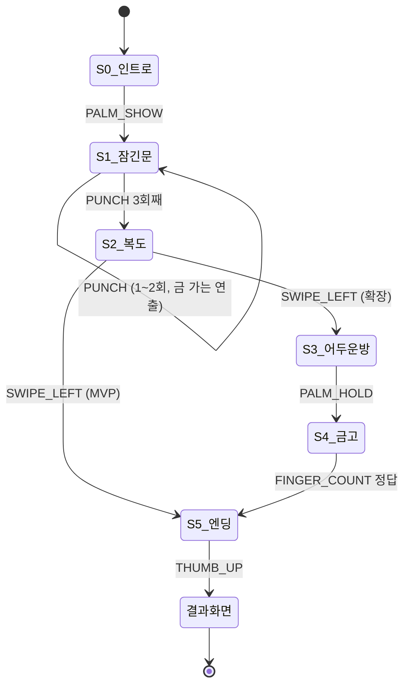
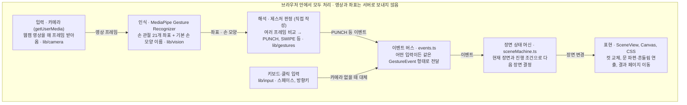
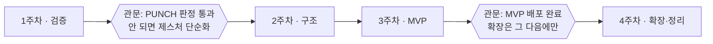

# 손으로 넘기는 웹툰 — MediaPipe 인터랙티브 스토리 뷰어 기획서

> 작성일: 2026-11-19
> 이 문서는 Claude Code 작업의 기준 문서다. 코딩 규칙은 루트의 `CLAUDE.md`를 따른다.

---

## 1. 프로젝트 개요

웹캠으로 손동작을 인식해 독자가 직접 이야기에 개입하는 웹툰 뷰어를 만든다. 주먹으로 문을 부수면 다음 장면이 열리고, 손을 휘두르면 컷이 넘어가며, 손바닥을 펴면 숨겨진 컷이 드러난다.

- **가칭:** 손으로 넘기는 웹툰 (Hand-Turned Toon)
- **기획 배경:** 웹툰은 스크롤로만 읽는 수동적인 콘텐츠다. 제스처를 장면 속 사건(문을 부숨, 커튼을 걷음)과 직접 연결하면 클릭보다 몰입감이 커진다. 제스처가 "기능"이 아니라 "이야기의 일부"라서 손을 쓰는 이유가 분명하다.

### 목표

1. 손 인식부터 장면 전환까지 브라우저 안에서 끊김 없이 동작하는 단편 에피소드 1편(5~6개 장면) 완성
2. 인식 로직과 화면 로직을 분리한 구조로, 같은 장면을 키보드·마우스로도 볼 수 있게 구현
3. 포트폴리오에서 "제스처를 이벤트로 추상화한 설계"를 설명할 수 있는 수준의 문서와 코드 정리

### 용어 풀이

- **MediaPipe:** 구글이 만든 오픈소스 도구 모음. 카메라 영상에서 손·얼굴·몸의 위치를 찾아주는 미리 학습된 AI 모델을 웹에서 바로 쓸 수 있게 해준다.
- **랜드마크(landmark):** 손목, 손가락 마디 같은 기준점의 좌표. 손 하나당 21개 점이 나온다.

---

## 2. 타깃 사용자와 사용 시나리오

주 사용자는 노트북 웹캠이 있는 20~30대 웹툰 독자이고, 부 사용자는 포트폴리오를 보는 채용 담당자다. 두 번째 사용자는 카메라를 켜지 않을 가능성이 높으므로 대체 조작이 필수다.

| 사용자 | 상황 | 기대하는 것 | 설계 대응 |
| --- | --- | --- | --- |
| 웹툰 독자 | 집에서 노트북으로 신작 홍보 페이지 접속 | 짧고 강렬한 체험, 공유하고 싶은 장면 | 3분 안에 끝나는 단편, 마지막에 결과 화면 |
| 채용 담당자 | 업무 중 포트폴리오 링크 확인 | 카메라 없이도 빠르게 핵심 파악 | 키보드·클릭 대체 조작, 데모 영상 링크 |
| 카메라 거부 사용자 | 권한 팝업에서 "차단" 선택 | 그래도 이야기를 끝까지 보기 | 자동으로 마우스 모드 전환 |

### 대표 시나리오 (독자)

1. 첫 화면에서 "손으로 읽기 시작" 버튼을 누르고 카메라 권한을 허용한다.
2. 화면 구석에 작은 손 인식 미리보기가 뜨고, "손바닥을 보여주세요" 안내로 인식을 확인한다.
3. 주인공이 잠긴 문 앞에 선다. 주먹을 카메라 쪽으로 세 번 내지르면 문에 금이 가다가 부서진다.
4. 손을 왼쪽으로 휘둘러 다음 컷으로 넘기고, 어두운 방에서 손바닥을 펴 숨겨진 단서 컷을 연다.
5. 마지막 장면 후 결과 화면(찾은 단서 수, 다시 보기)으로 이동한다.

---

## 3. 스토리와 장면 구성

단편 1편은 6개 장면, 체험 시간 약 3분으로 잡는다. 장면마다 제스처는 하나만 요구해 처음 쓰는 사람도 헷갈리지 않게 한다.

**가안 스토리: 「잠긴 연구실」** — 주인공이 사라진 동료를 찾아 폐쇄된 연구실에 들어가 단서를 모으는 미스터리.

| 장면 | 내용 | 요구 제스처 | 성공 시 연출 |
| --- | --- | --- | --- |
| S0 인트로 | 카메라 권한 안내, 손 인식 테스트 | 손바닥 보이기 | "준비 완료" 표시 후 S1 |
| S1 잠긴 문 | 연구실 문이 굳게 잠김 | 주먹 내지르기 3회 | 금 감 → 크게 갈라짐 → 파편과 함께 부서짐 |
| S2 복도 | 긴 복도를 걸어감 (컷 3장) | 왼쪽으로 휘두르기 | 컷이 옆으로 밀려 넘어감 |
| S3 어두운 방 | 불 꺼진 실험실 | 손바닥 펴서 유지 1초 | 손 위치를 따라 손전등처럼 밝아지며 숨은 단서 컷 공개 |
| S4 금고 | 비밀번호 잠금 | 손가락 개수로 숫자 입력 (1~5) | 잠금 해제 애니메이션 |
| S5 엔딩 | 동료의 메모 발견 | 엄지 올리기 | 결과 화면으로 이동 |

**MVP 범위:** S0, S1, S2, S5만 먼저 만든다. S3(손전등)와 S4(손가락 숫자)는 확장 단계에서 추가한다.

### 장면 흐름

---

## 4. 제스처 설계

모양만 보면 되는 제스처는 MediaPipe Gesture Recognizer의 기본 분류를 쓰고, 움직임이 필요한 제스처(내지르기, 휘두르기)는 여러 프레임의 좌표 변화를 직접 계산한다. 아래 수치는 시작값이며 실제 테스트로 조정한다.

| 이벤트 이름 | 동작 | 판정 방법 | 오인식 방지 |
| --- | --- | --- | --- |
| `PALM_SHOW` | 손바닥 보이기 | 기본 분류 `Open_Palm` | 0.5초 이상 유지 시 확정 |
| `PUNCH` | 주먹 내지르기 | `Closed_Fist` 상태 + 손 크기(손목~중지 뿌리 거리)가 약 0.2초 안에 30% 이상 커짐 | 1회 판정 후 0.6초 쿨다운 |
| `SWIPE_LEFT` / `SWIPE_RIGHT` | 손 휘두르기 | 손목 x좌표가 약 0.3초 안에 화면 폭의 25% 이상 이동 | 이동 방향 반대 흔들림 무시, 쿨다운 0.8초 |
| `PALM_HOLD` | 손바닥 펴서 유지 | `Open_Palm` 1초 유지 + 손 중심 좌표 전달 | 손이 사라지면 즉시 해제 |
| `FINGER_COUNT` | 손가락 개수 | 각 손가락 끝이 둘째 마디보다 바깥에 있는지 비교 | 같은 값 0.7초 유지 시 확정 |
| `THUMB_UP` | 엄지 올리기 | 기본 분류 `Thumb_Up` | 0.5초 유지 |

### 용어 풀이

- **Gesture Recognizer:** MediaPipe가 미리 학습해둔 손 모양(주먹, 펼친 손, 엄지 척, 브이 등)을 이름으로 알려주는 기능. 모양만 판단하고 움직임은 판단하지 않는다.
- **쿨다운(cooldown) / 디바운스(debounce):** 한 번 인식한 뒤 짧은 시간 동안 같은 입력을 무시하는 것. 주먹 한 번이 프레임마다 반복 인식되어 "10번 때림"으로 처리되는 것을 막는다.
- **정규화 좌표:** MediaPipe 좌표는 픽셀이 아니라 0~1 사이 비율로 나온다. 그래서 "화면 폭의 25%"처럼 기준을 잡으면 카메라 해상도와 상관없이 같은 기준을 쓸 수 있다.

**손 크기로 거리를 재는 이유:** 손이 카메라에 가까워지면 화면에서 커진다. z좌표(깊이)도 제공되지만 손목 기준의 상대값이라 "카메라 쪽으로 다가옴"을 재기에는 손 크기 변화가 더 직관적이다. 실제 정확도는 프로토타입에서 두 방식을 비교해 확인한다.

---

## 5. 기능 명세

MVP는 "문 부수기 → 컷 넘기기 → 엔딩"이 카메라와 키보드 양쪽에서 끝까지 동작하는 것이다. 확장 기능은 MVP가 안정된 뒤에만 착수한다.

| 구분 | 기능 | 설명 | 우선순위 |
| --- | --- | --- | --- |
| 입력 | 카메라 연결 | 권한 요청, 실패 시 대체 모드 전환 | MVP |
| 입력 | 손 인식 미리보기 | 화면 구석에 작은 영상 + 손가락 점 표시 | MVP |
| 입력 | 키보드·클릭 대체 조작 | 스페이스=PUNCH, 방향키=SWIPE, H=PALM | MVP |
| 해석 | PUNCH / SWIPE / PALM_SHOW / THUMB_UP 판정 | 4장 표의 기준 적용 | MVP |
| 장면 | 장면 상태 머신 | 장면 순서와 진행 조건 관리 | MVP |
| 장면 | 문 파괴 연출 | 3단계 이미지 교체 + 화면 흔들림 + 파편 | MVP |
| 장면 | 컷 넘김 애니메이션 | 휘두른 방향으로 슬라이드 | MVP |
| 결과 | 엔딩·결과 화면 | 다시 보기, 처음으로 | MVP |
| 인식 | 손전등 효과 (S3) | 손 좌표를 따라 원형으로 밝히기 | 확장 |
| 인식 | 손가락 숫자 입력 (S4) | FINGER_COUNT 이벤트 | 확장 |
| 편의 | 인식 감도 설정 | 쿨다운·임계값 조절 슬라이더 | 확장 |
| 편의 | 효과음 | 타격음, 넘김 소리 | 확장 |
| 공유 | 결과 공유 | 찾은 단서 수 이미지로 저장 | 확장 |
| 데이터 | 장면 데이터 분리 | 장면 정보를 데이터 파일로 관리해 새 에피소드 추가 쉽게 | 확장 |

---

## 6. 시스템 아키텍처

카메라 입력과 키보드 입력이 모두 "이벤트 버스"에서 같은 형태로 합쳐지고, 장면은 이벤트만 보고 움직인다. 이 분리 덕분에 카메라가 없어도 같은 흐름이 동작하고, 인식 로직을 바꿔도 장면 코드는 그대로다.

직접 작성하는 핵심 코드는 "해석"과 "장면 상태 머신" 두 곳이다.

### 용어 풀이

- **이벤트 버스(event bus):** 여러 곳에서 보낸 신호를 한곳에 모아, 그 신호를 기다리는 코드에 전달하는 중계소. 보내는 쪽과 받는 쪽이 서로를 몰라도 된다.
- **상태 머신(state machine):** "지금 어느 단계인지"를 정해진 칸 중 하나로만 관리하는 방식. 문이 부서지지 않았는데 다음 장면으로 넘어가는 오류를 막는다.
- **getUserMedia:** 브라우저가 카메라·마이크 사용 권한을 요청하고 영상을 받아오는 기본 기능.

---

## 7. 기술 스택과 코드 방향성

이미 익숙한 Next.js + TypeScript를 그대로 쓰고, 새로 배우는 것은 MediaPipe와 애니메이션에 집중한다. 서버는 필요 없고 Vercel 정적 배포로 충분하다.

| 영역 | 선택 | 이유 |
| --- | --- | --- |
| 프레임워크 | Next.js (App Router) + TypeScript | 기존 경험 활용, 라우팅·배포 간편 |
| 손 인식 | `@mediapipe/tasks-vision` (Gesture Recognizer) | 현재 공식 웹 패키지. 손 좌표와 기본 제스처를 한 번에 제공 |
| 장면 표현 | CSS 애니메이션 + Canvas 2D | 파편·손전등 효과는 Canvas, 나머지는 CSS로 충분 |
| 상태 관리 | React `useReducer` (필요 시 Zustand) | 장면 상태가 단순해 외부 라이브러리 없이 시작 |
| 배포 | Vercel | 카메라 사용에 필요한 HTTPS 기본 제공 |

폴더 구조와 코딩 규칙은 `CLAUDE.md`를 참고한다.

### 코드 방향성

1. **이벤트로 추상화한다.** 장면 컴포넌트는 좌표를 모른다. `gestures/`가 `{ type: 'PUNCH' }` 같은 이벤트만 내보내고, 키보드 입력도 같은 이벤트를 만든다. 그래서 카메라 없이도 모든 장면을 테스트할 수 있다.
2. **판정 로직은 순수 함수로 만든다.** "최근 N프레임 좌표 → 이벤트 또는 없음"을 반환하는 함수로 짜면, 녹화한 좌표 데이터로 단위 테스트를 할 수 있다. (순수 함수: 같은 입력에 항상 같은 결과를 내고 외부 상태를 건드리지 않는 함수)
3. **장면은 데이터로 정의한다.** `episode1.ts`에 "S1은 PUNCH 3회가 필요하고 다음은 S2"처럼 적어두면, 새 장면 추가 시 컴포넌트 코드를 거의 안 고친다.
4. **브라우저 전용 코드를 분리한다.** MediaPipe와 카메라는 브라우저에서만 동작하므로 해당 컴포넌트는 `"use client"`로 두고, 필요하면 `dynamic import`로 서버 렌더링에서 제외한다.
5. **프레임 루프는 하나만 돈다.** `requestAnimationFrame`(브라우저가 다음 화면을 그리기 직전에 함수를 호출해주는 기능) 루프에서 인식을 한 번만 실행하고, 결과를 이벤트 버스로 뿌린다.

인터넷의 MediaPipe 예제 중 상당수는 예전 패키지(`@mediapipe/hands` 등) 기준이라, 코드는 [공식 문서](https://ai.google.dev/edge/mediapipe/solutions/vision/gesture_recognizer/web_js) 기준으로 확인하며 작성한다.

---

## 8. 화면 구성

페이지는 인트로, 뷰어, 결과 3개다. 뷰어 화면은 웹툰 컷이 중심이고, 조작 안내와 카메라 미리보기는 방해되지 않게 가장자리에 둔다.

| 화면 | 경로 | 주요 요소 |
| --- | --- | --- |
| 인트로 | `/` | 작품 제목, "손으로 읽기" / "키보드로 읽기" 버튼 2개, 카메라 사용 안내(영상은 기기 밖으로 전송되지 않음) |
| 뷰어 | `/story` | 중앙 컷 영역(세로형 웹툰 비율), 하단 제스처 안내 아이콘, 우측 하단 카메라 미리보기(손가락 점 표시), 진행 표시(S1/6) |
| 결과 | `/result` | 찾은 단서 수, 다시 보기, 처음으로 |

### 뷰어 화면 배치 원칙

- 제스처 안내는 그림 아이콘 + 짧은 문구(예: 주먹 아이콘 + "문을 세게 쳐보세요")로 표시한다.
- 인식 중인 상태를 항상 보여준다. 손이 안 보이면 미리보기 테두리를 회색으로, 인식되면 강조색으로 바꾼다.
- 판정 직전 피드백을 준다. 예를 들어 주먹을 쥐면 문이 살짝 흔들려서 "인식되고 있다"는 걸 알린다.
- 모바일은 세로 화면 + 전면 카메라 기준으로 같은 배치를 쓰되, 미리보기는 더 작게 줄인다.

---

## 9. 예외 처리, 접근성, 개인정보

원칙은 "카메라가 안 돼도 이야기는 끝까지 볼 수 있다"이다. 모든 실패 상황은 키보드·클릭 모드로 자연스럽게 넘어간다.

| 상황 | 처리 |
| --- | --- |
| 카메라 권한 거부 | 안내 문구 후 키보드·클릭 모드로 자동 전환 |
| 카메라 없음 / 다른 앱이 사용 중 | 같은 방식으로 전환, 재시도 버튼 제공 |
| 모델 파일 로딩 실패·지연 | 로딩 표시, 일정 시간 초과 시 대체 모드 제안 |
| 손이 화면 밖으로 나감 | "손을 화면 안으로" 안내, 진행 상태는 유지 |
| 조명이 어두워 인식률 낮음 | 일정 시간 인식 실패 시 "밝은 곳에서 해보세요" 또는 버튼 조작 제안 |
| 같은 장면에서 오래 막힘 | 15초 후 "건너뛰기" 버튼 노출 |
| HTTP 환경 | 카메라는 HTTPS 또는 localhost에서만 동작하므로 배포는 HTTPS 필수 |

### 접근성

- 모든 제스처에 키보드 대응 키를 두고, 화면 안내에도 함께 표기한다.
- 화면 흔들림·번쩍임 효과는 운영체제의 "동작 줄이기" 설정(`prefers-reduced-motion`)이 켜져 있으면 약하게 한다.
- 컷 이미지에는 대체 텍스트를 넣어 화면 낭독기로도 줄거리를 따라갈 수 있게 한다.

### 개인정보

- 손 인식은 브라우저 안에서 처리되고, 영상과 좌표는 서버로 보내지 않는다. 인트로 화면에 이 사실을 명시한다.
- 결과 공유 기능(확장)에는 카메라 이미지를 포함하지 않는다.
- 장면을 벗어나거나 페이지를 닫으면 카메라 스트림을 즉시 정지한다.

---

## 10. 개발 일정과 작업 체크리스트

전체 4주를 가정한 일정이며, 실습 기간에 맞춰 주 단위를 늘리거나 줄인다. 핵심은 첫 주에 가장 어려운 판정부터 검증하는 것이다. 두 관문을 통과하지 못하면 다음 단계로 넘어가지 않고, 범위를 줄여 해당 주에 마무리한다.

> Claude Code는 아래 체크박스를 위에서부터 하나씩 진행하고, 완료 시 `[x]`로 갱신한다.

### M1 — 1주차 · 검증

- [x] Next.js + TypeScript 프로젝트 생성, `@mediapipe/tasks-vision` 설치
- [x] MediaPipe 연결: 카메라 영상 + 손 랜드마크 21개 점을 Canvas에 표시하는 테스트 페이지
- [ ] PUNCH 단독 테스트 페이지 (판정 결과와 손 크기 변화량을 화면에 숫자로 표시)
- [ ] 판정값 조정 기록 (아래 "오인식 개선 기록" 표 작성)
- [ ] **관문:** PUNCH 판정이 쓸 만한지 확인. 안 되면 "주먹 쥐고 유지"로 단순화 결정

### M2 — 2주차 · 구조

- [ ] `CLAUDE.md` 기준 폴더·계층 분리
- [ ] `GestureEvent` 타입과 이벤트 버스 구현 (`lib/events.ts`)
- [ ] 키보드 입력 → 같은 이벤트 변환 (`lib/input`)
- [ ] 장면 상태 머신 + 장면 데이터 (`scenes/`)
- [ ] S0 인트로, S1 잠긴 문 장면 (문 3단계 이미지 + 흔들림 + 파편)

### M3 — 3주차 · MVP

- [ ] SWIPE 판정 + S2 복도 장면
- [ ] THUMB_UP 판정 + S5 엔딩 + 결과 화면
- [ ] 키보드 대체 조작으로 처음부터 끝까지 통과 확인
- [ ] 9장 예외 처리 (권한 거부, 카메라 없음, 로딩 실패, 건너뛰기)
- [ ] Vercel 배포
- [ ] **관문:** 배포 링크에서 카메라·키보드 모드 모두 끝까지 동작

### M4 — 4주차 · 확장·정리

- [ ] S3 손전등 (PALM_HOLD), S4 금고 (FINGER_COUNT)
- [ ] 오인식 개선 기록 정리
- [ ] README (아키텍처 그림, 제스처 판정 기준표), 30초 데모 영상
- [ ] 회고 정리

### 오인식 개선 기록

| 날짜 | 제스처 | 변경 내용 (전 → 후) | 테스트 결과 |
| --- | --- | --- | --- |
| 2026-11-19 | PALM_SHOW · PUNCH · THUMB_UP (손 모양) | 기본 분류만 → 기본 분류가 None이면 21개 3D 좌표로 손가락 펴짐·접힘 직접 판정 (펴짐 비율 > 1.3, 접힘 < 1.0, 엄지 > 0.6) | 기본 분류는 손바닥·앞면에서만 인식, 손등·옆모습·잘린 손은 None (점은 그려짐). 실측: 손등 손바닥·옆모습 엄지 척 인식 성공. 카메라로 뻗은 주먹은 기본 분류 None/Thumb_Down이지만 좌표 판정 fist (손가락 비율 0.52~0.56, 엄지 0.30~0.60). 엄지 척 엄지 0.6~0.8 → 엄지 값만으로는 겹치나 "엄지 끝 최상단" 조건으로 구분되어 기준 유지 |

---

## 11. 실무 활용과 포트폴리오 포인트

이 프로젝트의 핵심 역량은 "불안정한 입력(카메라 인식)을 안정적인 UI 이벤트로 바꾸는 설계"이고, 이는 제스처가 아닌 업무에도 그대로 쓰인다.

| 실무 상황 | 이 프로젝트에서 쓴 기술이 어떻게 쓰이는가 |
| --- | --- |
| 콘텐츠 플랫폼의 신작 홍보·이벤트 페이지 | 장면 상태 머신 + 인터랙션 연출을 짧은 기간에 만드는 경험 |
| 동영상·라이브 서비스의 카메라 기능 (필터, 가상 배경 등) | 카메라 권한 처리, 프레임 루프, 브라우저 내 AI 모델 로딩 |
| 헬스케어·홈트 서비스의 자세 피드백 | 같은 MediaPipe 계열 모델(Pose Landmarker)로 좌표 → 각도 계산 → 피드백 이벤트 구조 재사용 |
| 일반 웹 서비스의 복잡한 UI 흐름 (결제 단계, 온보딩) | 상태 머신으로 "지금 어느 단계인지"를 명확히 관리하는 설계 |
| 입력 장치가 다양한 서비스 (키오스크, 접근성 대응) | 여러 입력을 하나의 이벤트로 통합하는 추상화 |

### 면접에서 말할 포인트

1. 왜 손을 쓰는가: 제스처를 장면 속 사건과 연결해 몰입감을 만들었다.
2. 어떻게 안정화했는가: 쿨다운, 유지 시간, 여러 프레임 비교로 오인식을 줄였고, 조정 전후 오인식 횟수를 기록해 수치로 보여준다.
3. 어떻게 설계했는가: 인식·해석·장면 계층을 분리해 키보드로도 같은 흐름이 동작한다.
4. 무엇을 배려했는가: 카메라 거부·저조도·동작 줄이기 설정까지 대응했다.

**남길 산출물:** README(아키텍처 그림, 제스처 판정 기준표), 30초 데모 영상, 오인식 개선 기록, 배포 링크.

---

## 12. 리스크와 확인 필요 사항

가장 큰 리스크는 "주먹 내지르기" 판정이 환경(조명, 카메라 각도, 거리)에 따라 흔들리는 것이다. 그래서 1주차에 판정 프로토타입부터 검증한다.

| 리스크 | 영향 | 대응 |
| --- | --- | --- |
| PUNCH 판정 정확도 부족 | 핵심 장면이 답답해짐 | 1주차에 단독 테스트 페이지로 검증, 안 되면 "주먹 쥐고 유지"로 단순화 |
| 저사양 노트북에서 프레임 저하 | 인식 지연, 연출 끊김 | 입력 영상 해상도 축소, 인식 주기 조절 |
| 웹툰 그림 리소스 부족 | 완성도 저하 | 직접 그리기 어려우면 단순한 플랫 일러스트·실루엣 스타일로 통일, 이미지 출처·라이선스 기록 |
| 일정 초과 | 미완성 | MVP 장면 4개만 먼저 완성 후 확장 |

### 확인 필요 사항 (아직 검증 안 됨)

- [ ] Gesture Recognizer 한 개로 충분한지, Hand Landmarker를 따로 써야 하는지 (좌표는 둘 다 제공하는 것으로 알려져 있으나 공식 문서로 재확인)
- [ ] 모바일 브라우저(iOS Safari, Android Chrome)에서 실제 동작과 속도
- [ ] 손 크기 방식 vs z좌표 방식 중 PUNCH 판정에 더 안정적인 쪽
- [ ] 모델 파일을 외부 주소에서 불러올지, 프로젝트 안(`public/`)에 둘지
- [ ] 웹툰 이미지 제작 방법 (직접 제작 / 무료 리소스 / AI 이미지 도구 사용 시 이용 약관)
